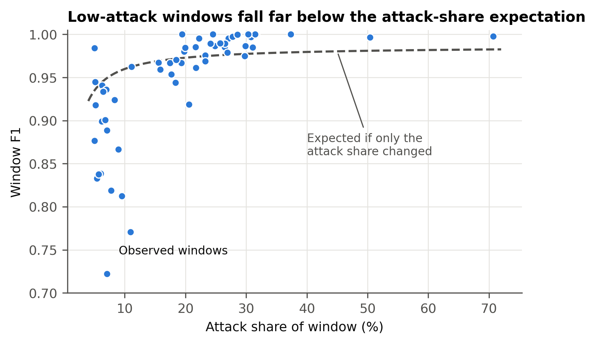
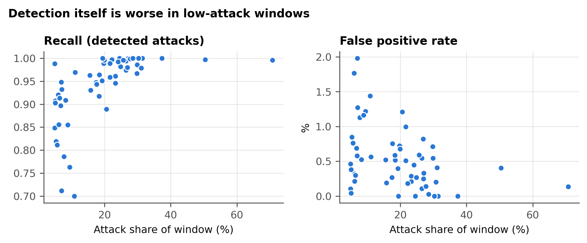
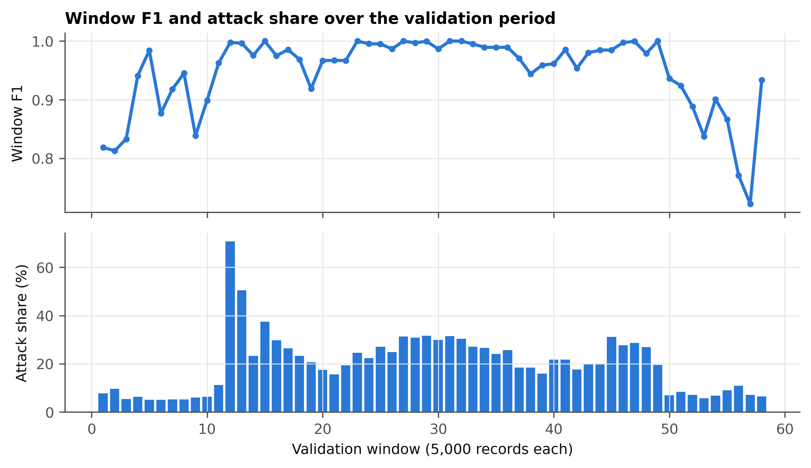
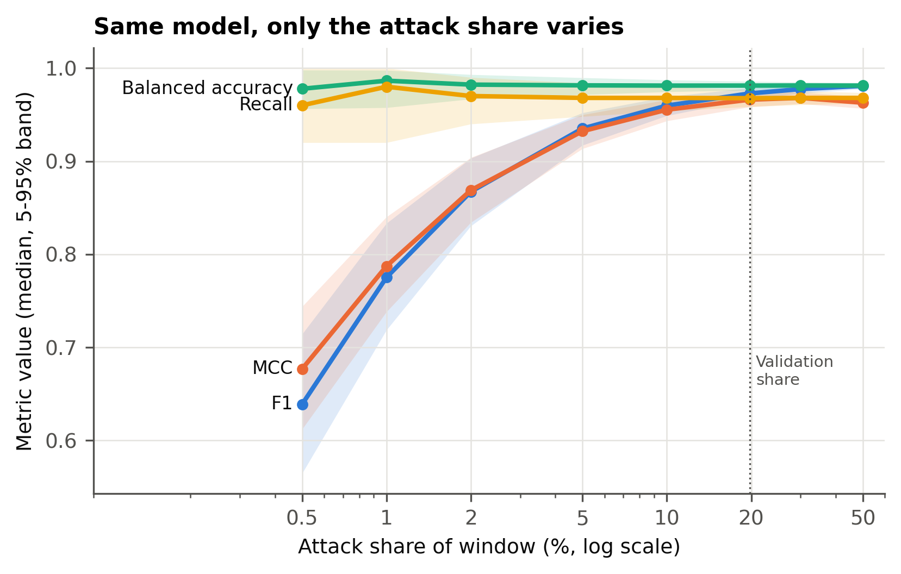
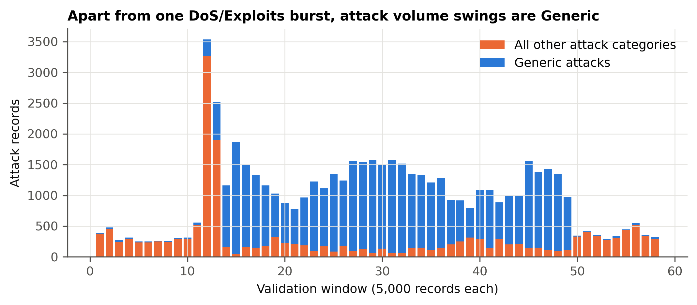
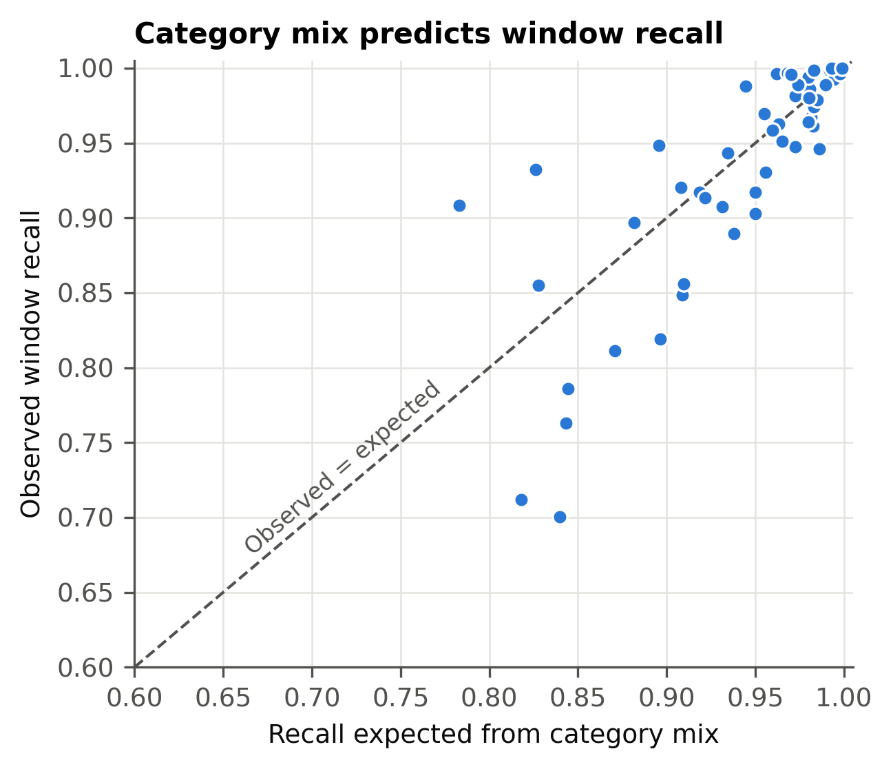

# Attack share and window-level performance

Analysis of the Random Forest baseline's 58 validation windows (5,000 records each).
Produced by `scripts/analyze_attack_share.py` from `results/validation_predictions.csv`.
All numbers below come from the files in this folder.

**Status:** complete for the validation partition. The category tables were produced
on the machine holding the raw data (`scripts/export_validation_categories.py`, 0
label/category mismatches); everything else is recomputed from committed files.
A within-category comparison by period needs one more local re-run to create
`category_window_counts.csv`.

## Question

Validation F1 varies widely between windows (0.72 to 1.00), and windows with few
attacks have lower F1. Is that because F1 mechanically depends on the attack share, or
because the model really detects worse in those windows? The answer decides whether
Strategy B's F1-drop rule would raise false degradation alarms, and whether changing
the metric would fix it.

## Findings

### 1. Most of the variation is real performance change, not arithmetic

If recall and false positive rate were constant at their pooled values (96.8% and
0.54%), the attack share alone would produce window F1 with a standard deviation of
0.015. The observed standard deviation is 0.064.

| Counterfactual | R² against observed window F1 |
|---|---:|
| Only the attack share changes (pooled recall and FPR) | 0.17 |
| Only recall and FPR change (pooled attack share) | 0.88 |

Figure 1 shows this directly: low-attack windows sit far below the curve that the
attack share alone would predict.

### 2. Detection is genuinely worse in low-attack windows

| Mean over windows | Attack share < 12% (20 windows) | ≥ 12% (38 windows) |
|---|---:|---:|
| Recall | 0.868 | 0.978 |
| False positive rate | 0.79% | 0.37% |
| Balanced accuracy | 0.930 | 0.987 |
| ROC AUC | 0.994 | 0.9995 |
| F1 | 0.880 | 0.983 |

Metrics that do not depend on the attack share (recall, FPR, balanced accuracy, ROC AUC)
also correlate with it (Spearman ρ = 0.79, −0.43, 0.79 and 0.74). So the low-attack
windows contain traffic the model handles worse. Finding 5 shows why: they contain a
different mix of attack categories.

ROC AUC stays above 0.99 even in the low-attack windows, so the model still ranks most
attacks above normal traffic there; the misses are partly a threshold effect. Of the
1,849 missed validation attacks, 839 (45%) have an attack probability of at least 0.3.

The low-attack windows are not scattered: they form two contiguous periods at the
start (windows 1-10) and end (windows 50-58) of the validation period.

### 3. Controlled experiment: the pure attack-share effect

To isolate the arithmetic effect, attacks and normal records were resampled separately
from the pooled validation predictions (4,000 simulated windows per share, seed
20261108). Per-class behaviour is therefore identical at every share; only the mix
changes.

| Attack share | F1 (median) | MCC | Balanced accuracy | Recall |
|---:|---:|---:|---:|---:|
| 0.5% | 0.639 | 0.677 | 0.978 | 0.960 |
| 1% | 0.775 | 0.787 | 0.986 | 0.980 |
| 2% | 0.867 | 0.869 | 0.982 | 0.970 |
| 5% | 0.935 | 0.932 | 0.981 | 0.968 |
| 10% | 0.960 | 0.955 | 0.981 | 0.968 |
| 19.8% (validation) | 0.973 | 0.966 | 0.981 | 0.968 |
| 50% | 0.981 | 0.963 | 0.981 | 0.968 |

With the Strategy B rule (drop of at least 0.05 below the value at the validation share,
in two consecutive windows, streams of 20 windows), the share of streams raising a
false degradation alarm is:

| Attack share | F1 | MCC | Balanced accuracy | Recall |
|---:|---:|---:|---:|---:|
| 0.5%-2% | 100% | 100% | 0% | ≤3% |
| 5% | 25% | 11% | 0% | 0% |
| ≥10% | 0% | 0% | 0% | 0% |

So the arithmetic effect is small within UNSW-NB15's observed range (5-71%) but decisive
below about 5%, which is where real networks usually operate.

### 4. The reference period decides what counts as degradation

Applying the Strategy B rule to the unshifted validation sequence:

| Reference | Confirmed alarms (F1) | First alarm |
|---|---:|---:|
| Mean of windows 1-10, monitoring windows 11-58 | 1 | window 57 |
| Mean of all validation windows | 5 | window 2 |

The two candidate references disagree because windows 1-10 are themselves a
low-performance, low-attack period. With that reference, the drop at the end of the
validation period (F1 down to 0.72) is mostly not flagged; with the overall mean,
the start of the period is flagged. The same pattern holds for MCC, balanced accuracy
and recall (`alarms_on_validation.csv`), so changing the metric alone does not solve it.

### 5. The attack categories explain it: Generic attacks dominate the headline numbers

| Category | Validation attacks | Recall | Share of all missed attacks |
|---|---:|---:|---:|
| Generic | 39,913 (69%) | 1.000 | 0.1% |
| Exploits | 7,198 | 0.985 | 5.8% |
| Fuzzers | 3,946 | 0.581 | **89.4%** |
| DoS | 2,948 | 0.992 | 1.4% |
| Reconnaissance | 2,540 | 0.996 | 0.5% |
| Backdoor | 367 | 0.997 | 0.1% |
| Analysis | 349 | 0.857 | 2.7% |
| Shellcode | 252 | 0.996 | 0.1% |
| Worms | 31 | 1.000 | 0% |

- **The attack-share swings are Generic attacks.** The number of Generic attacks per
  window rises with the attack share (Spearman ρ = 0.89); the number of all other
  attacks does not (ρ = −0.61). Low-attack windows have about 20 Generic attacks and
  333 others; high-attack windows have about 1,040 Generic and 288 others. The one
  exception is a DoS/Exploits burst in windows 12-13, which the model also detects
  well (recall 0.996).
- **The category mix predicts window recall.** If each category kept its pooled recall,
  the mix alone would give a recall of 0.884 in low-attack windows and 0.979 in
  high-attack windows (observed: 0.868 and 0.978). The mix explains R² = 0.67 of the
  variation in window recall (Spearman ρ = 0.88).
- **Fuzzers are the real weakness.** They are 26% of attacks in low-attack windows but
  4% in high-attack windows, and account for 89% of all missed attacks. Excluding
  Generic, pooled recall is 0.895, not 0.968.
- **False positives rise with Fuzzers too** (Spearman ρ = 0.68 between window FPR and
  the Fuzzers share), consistent with Fuzzers traffic overlapping with normal traffic.
  This is a correlation; it is not yet tested directly.

The overall validation F1 of 0.973 therefore mostly measures how well the model detects
Generic attacks, which it detects almost perfectly. When Generic attacks are absent, the
same model has visibly lower performance, with no change to the model.

## Implications

- **For Strategy B:** a single global reference value is fragile because validation
  traffic is not homogeneous. The reference period should cover the traffic regimes the
  model is expected to see, or the reference should be conditioned on the traffic
  regime (for example the attack share or category mix).
- **For the metric:** F1 and MCC should not be the only monitored metric if deployment
  attack shares can fall below about 5%. Recall with FPR, or balanced accuracy, is
  stable under pure attack-share change.
- **For reporting:** report recall per attack category, and overall metrics with and
  without Generic. A single pooled F1 on UNSW-NB15 hides that 89% of misses come from
  one category.
- **For monitoring:** a change in the attack-category mix changes measured performance
  without any change to the model. Strategy A should treat category-mix shift as a
  possible cause, and Strategy B's reference should match the mix being monitored.
- **For the experiments:** scenarios that inject a shift should hold the attack share
  and category mix fixed, or vary them on purpose, so their effect is not mistaken for
  the injected shift.

## Limitations

- One dataset, one model, one session (February 18), validation partition only.
- Resampling assumes records are exchangeable within each class; it isolates the
  arithmetic effect but does not model correlated traffic within a window.
- The low/high split at 12% is descriptive; the correlations do not depend on it.
- The category mix explains two-thirds of recall variation; the remaining third (for
  example whether Fuzzers are themselves harder in some periods) needs the per-window,
  per-category counts.
- Check the literature on known UNSW-NB15 issues before claiming Generic dominance as
  new; it may already be reported and should then be cited.

## Files

| File | Contents |
|---|---|
| `window_metrics_extended.csv` | Per-window counts, recall, FPR, precision, F1, MCC, balanced accuracy, ROC AUC, average precision, and the two F1 counterfactuals |
| `alarms_on_validation.csv` | Strategy B alarms on the observed sequence, per metric and reference |
| `resampling_quantiles.csv` | 5th, 50th and 95th percentiles of each metric per simulated attack share |
| `resampling_alarm_rates.csv` | Per-window flag rate and per-stream alarm rate, per metric and share |
| `summary.json` | All headline numbers, settings and provenance |
| `category_recall.csv` | Validation attacks and recall per category |
| `category_mix_by_window.csv` | Share of each category among a window's attacks |
| `figures/` | Figures 1-6 as PNG and PDF |
